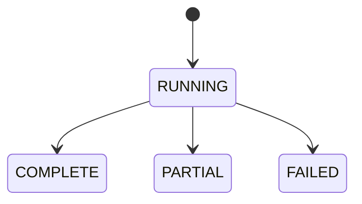

# Segmentos, protocolos, ejecuciones y observaciones

Incremento 4, 2026-11-14. Funcionalidad manual implementada. [Plan general](PLAN_OBSERVATORIO_MERCADO.md).

## Cómo utilizarlo

1. En Observatorio, entra en **Segmentos y capturas** (`/observatory/captures`). Crea un segmento: familia de puesto, país, nivel y modalidad que deseas estudiar. Los campos opcionales sin definir no se convierten en valores inferidos.
2. Crea un protocolo que fije una versión del segmento: fuente, consulta, instrucciones de filtros, frecuencia prevista, límite, orden, paginación y tipo de muestra. La frecuencia es sólo configuración: todavía no programa consultas automáticas.
3. Inicia una ejecución del protocolo. Selecciona un anuncio existente y abre **Registrar observación de este anuncio**. Si es un anuncio nuevo, regístralo primero en el observatorio; su evidencia inicial permanece como registro exploratorio independiente.
4. Registra la disponibilidad y la fecha de la nueva consulta. Si está disponible, conserva el texto que ves ahora y revisa los datos estructurados. Si el contenido cambió, actualiza la transcripción y las citas de habilidades/contexto. No encontrar el anuncio en resultados de búsqueda no equivale a haber comprobado que su página no está disponible.
5. Vuelve a Segmentos y capturas, selecciona la ejecución y finalízala indicando estado, páginas visitadas, truncamiento y notas cuando corresponda. La ejecución conserva sus observaciones y su configuración original aunque después edites el segmento o el protocolo.

No se invoca ningún scraper ni se crean registros en `jobs`, `applications`, los segmentos anteriores o sus automatizaciones.

## Identidad, versiones y muestra

- Segmentos y protocolos tienen identidad UUID e historial de versiones inmutables. Las ediciones requieren motivo y versión actual (`expectedRevision`); una edición obsoleta se rechaza con 400.
- El segmento tiene definición estructurada de familia de puesto, país ISO, seniority y modalidad, además de nombre/descripción. La familia es manual; no existe aún un catálogo de familias ni clasificación automática.
- Cada versión de protocolo apunta a una versión exacta del segmento. Su fuente única debe coincidir, sin distinguir mayúsculas, con la fuente del anuncio observado.
- Cada ejecución apunta a una versión exacta del protocolo. Cambiar el universo, consulta, filtros, frecuencia, orden o límite genera una nueva versión; nunca cambia el significado de ejecuciones anteriores.
- EXPLORATORY y SYSTEMATIC_MANUAL distinguen intención de muestreo. Una captura sistemática manual no es una muestra aleatoria ni garantiza representatividad.
- Filtros, orden y paginación son instrucciones textuales explícitas para recolección manual. Antes de ejecutarlos automáticamente se necesitarán contratos estructurados del conector; no se interpretan libremente como código o consultas.
- La pertenencia observada a una muestra se obtiene por la relación observación → ejecución → versión de protocolo → versión de segmento. No se reclasifican anuncios históricos por la definición actual del segmento. La relación expresa lo que se recogió bajo ese protocolo, no que un clasificador haya verificado todos los criterios.
- Las observaciones iniciales sin ejecución no se mezclan silenciosamente con muestras de protocolos. No se inventaron ejecuciones para los datos anteriores.

## Observación y transcripción son cosas distintas

Una observación conserva fuente, URL, fecha observada, fecha de registro, disponibilidad, texto recuperado y SHA-256 de su contenido exacto. No se normaliza el texto antes de calcular el hash. AVAILABLE exige texto; UNAVAILABLE y UNKNOWN conservan el evento sin texto, hash ni transcripción. No indican que hubo contratación, cierre definitivo o demanda cero.

Cada revisión estructurada del anuncio indica qué observación respalda sus citas. Cuando el texto y la interpretación no cambian, otra consulta genera una nueva observación y reutiliza la revisión actual. Un cambio de texto exige una transcripción completa nueva; un cambio de interpretación también genera revisión. Las cantidades se normalizan en escala y las habilidades se ordenan por identidad para que 30000 y 30000.00 o una lista reordenada no creen revisiones artificiales.

`dataRevision` en una observación es la transcripción conocida al registrarla. Una corrección posterior crea otra revisión ligada a la evidencia correspondiente, sin reescribir ese dato de la captura. Para análisis futuros se deberá elegir explícitamente entre la interpretación conocida al capturar y revisiones disponibles antes de una fecha de corte; no usar correcciones futuras en evaluaciones históricas.

`originalText` y `observedAt` del anuncio siguen representando su evidencia inicial por compatibilidad. Sus `observations` contienen el historial completo; cada `revision.observationId` selecciona su evidencia, que puede ser distinta de la inicial. El editor de correcciones valida contra esa evidencia, no contra el primer texto del anuncio.

`firstSeenAt` y `lastSeenAt` se derivan de observaciones AVAILABLE. Un evento de disponibilidad desconocida o no disponible no avanza la última fecha en que se vio disponible. La fecha de publicación sigue siendo un dato distinto.

Las observaciones de una ejecución deben ocurrir desde su inicio y hasta el momento actual, y no pueden ser anteriores a una observación ya guardada del mismo anuncio. No se habilitó importación retroactiva de ejecuciones. Las correcciones tienen fecha de registro propia y conservan la fecha original de su evidencia.

## Estados y salud de captura



- RUNNING permite registrar observaciones.
- COMPLETE requiere páginas visitadas explícitas y ausencia de truncamiento u observaciones UNKNOWN. Es una declaración del recolector de que completó el protocolo, no una comprobación automática de cobertura del portal.
- PARTIAL requiere motivo. Si se alcanzó el límite de resultados disponibles del protocolo, se exige declarar truncamiento y finalizar como parcial, incluso si no se sabe si había más resultados. Es una decisión conservadora.
- FAILED requiere motivo y no puede usarse si ya se recuperaron resultados AVAILABLE; en ese caso corresponde parcial. Puede conservar eventos UNKNOWN.
- Los estados finales son inmutables. Repetir la misma finalización devuelve el resultado existente; cambiar los parámetros o añadir nuevos elementos después de finalizar se rechaza.

`observationCount` cuenta eventos, no puestos, anuncios únicos, páginas o contrataciones. El límite del protocolo cuenta observaciones AVAILABLE. Dos elementos distintos de una ejecución pueden apuntar al mismo anuncio; no se ha implementado deduplicación entre elementos ni anuncios. Las métricas posteriores deberán respetar su unidad de análisis y no sumar estas observaciones como puestos distintos.

## Reintentos y transacciones

Iniciar una ejecución requiere `requestKey` UUID, única dentro de la identidad del protocolo. La misma clave y versión devuelve la ejecución existente, incluso finalizada; reutilizarla con otra versión falla. Una nueva consulta real debe usar otra clave.

Cada observación requiere `itemKey`, única dentro de una ejecución. Un reintento del mismo comando normalizado devuelve la observación guardada, también después del cierre, sin volver a aplicar una revisión obsoleta. Reutilizar la clave con datos diferentes falla. Se conserva una huella de solicitud SHA-256 para comprobarlo. El contrato de esta huella depende del esquema actual del comando: futuras ampliaciones deben mantener compatibilidad de reintentos o versionarlo explícitamente.

La interfaz conserva la clave durante un intento fallido de envío y la cambia después de confirmar éxito. La persistencia es transaccional y usa bloqueos de filas de protocolo, ejecución y anuncio para serializar reintentos, cierres y revisiones. Restricciones únicas y claves foráneas refuerzan la consistencia. Se verificó funcionalmente con H2; falta evaluar concurrencia y comportamiento de bloqueo con PostgreSQL real.

## API implementada

Bajo `/api/observatory`:

| Método y ruta | Operación |
| --- | --- |
| GET /segments | Versiones actuales de segmentos. |
| POST /segments | Crear con `{spec, reason}`. |
| PUT /segments/{id} | Añadir versión con `{expectedRevision, spec, reason}`. |
| GET /segments/{id}/history | Historial del segmento. |
| GET /protocols | Versiones actuales de protocolos. |
| POST /protocols | Crear con `{spec, reason}`. |
| PUT /protocols/{id} | Añadir versión con `{expectedRevision, spec, reason}`. |
| GET /protocols/{id}/history | Historial del protocolo. |
| POST /protocols/{id}/runs | Iniciar/reintentar con `{protocolRevision, requestKey}`. Responde 200 en ambos casos. |
| GET /runs?limit=25&offset=0 | Ejecuciones paginadas, límite 1–100. |
| GET /runs/{id} | Estado y metadatos de una ejecución. |
| PUT /runs/{id}/finish | Finalizar con `{state, pagesVisited, truncated, notes}`. |
| GET /runs/{id}/observations | Evidencia conservada de esa ejecución. |
| POST /runs/{id}/observations | Añadir/reintentar una observación. |

`POST /segments` y `POST /protocols` responden 201 con Location del historial. La API de anuncios conserva sus rutas y añade observaciones, fechas derivadas y la referencia de evidencia en cada revisión.

Ejemplo de definición de protocolo:

```json
{
  "spec": {
    "segmentId": "UUID-DEL-SEGMENTO",
    "segmentRevision": 1,
    "name": "Backend semanal",
    "source": "manual",
    "query": "Java backend",
    "filters": "México; remoto; sin filtro salarial",
    "intervalMinutes": 10080,
    "resultLimit": 100,
    "ordering": "Más recientes",
    "pagination": "Revisar páginas hasta agotar resultados o alcanzar el límite",
    "samplingMode": "SYSTEMATIC_MANUAL"
  },
  "reason": "Establecer captura inicial"
}
```

Ejemplo de observación de contenido sin cambios:

```json
{
  "itemKey": "elemento-1",
  "postingId": "UUID-DEL-ANUNCIO",
  "expectedRevision": 1,
  "observedAt": "INSTANTE-UTC-DURANTE-LA-EJECUCION",
  "availability": "AVAILABLE",
  "originalText": "Texto idéntico al que respalda la revisión actual",
  "data": null
}
```

Para contenido cambiado, incluir `data` completo, con requisitos y contexto que se quieran conservar y cuya evidencia aparezca en el nuevo texto. Para UNKNOWN/UNAVAILABLE, omitir texto y data. Los UUID y fechas de los ejemplos son marcadores que deben sustituirse por valores reales.

## Persistencia y transición

V13 agrega tablas de segmentos/versiones, protocolos/versiones, ejecuciones y observaciones. Las revisiones del anuncio referencian observaciones mediante clave foránea compuesta para impedir que utilicen evidencia de otro anuncio.

Los registros anteriores reciben una observación inicial con sus fechas y texto originales; todas sus correcciones previas quedan vinculadas a esa evidencia. No se fabrican protocolos, ejecuciones ni otras fechas. El hash de esa evidencia heredada se calcula al leer si no estaba almacenado. La migración se probó desde V12 con anuncios y correcciones existentes.

La evidencia se conserva por observación aunque el texto coincida. La deduplicación de almacenamiento por hash es una optimización futura; conservar otra observación nunca significa otra oportunidad laboral.

## Qué sigue pendiente

Fase 2 continúa parcial: identidad por fuente, detección/revisión de duplicados, unión/separación reversible, auditoría y adaptación de conectores, captura automática y programación independiente. También falta incorporar altas nuevas directamente desde una ejecución, filtros ejecutables por conector y clasificación de pertenencia con evidencia. El flujo manual actual exige registrar primero el anuncio y luego seleccionarlo en la captura.

Fases 3–7 siguen pendientes: dashboard y métricas reproducibles, estadística inferencial, simulaciones, pronósticos y operación ampliada. No se presentaron conteos de eventos como métricas de demanda ni se modificó el seguimiento existente.
