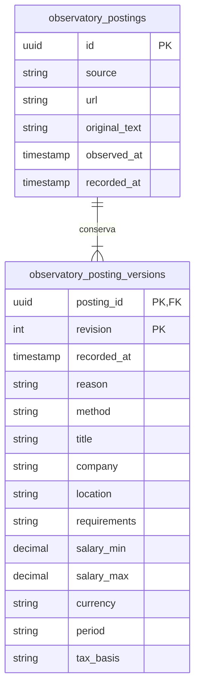

# Observatorio: contratos del primer incremento

Fecha: 2026-11-14. Complementa el [plan](PLAN_OBSERVATORIO_MERCADO.md).

## Glosario e identidad

- Anuncio: registro independiente identificado por UUID; todavía no equivale a un puesto real único.
- Evidencia original: texto copiado, fuente, URL opcional y fecha en que se observó. Es inmutable desde la API.
- Fecha de registro: momento del servidor en que se añadió la evidencia. No sustituye la fecha de publicación.
- Versión: transcripción estructurada inicial o corrección humana completa; se conserva fecha, motivo y método.
- Desconocido: `null`, no cero ni un valor inferido. Los campos textuales estructurados vacíos se convierten a `null`.
- Comparabilidad salarial básica: al menos un extremo, moneda, periodo y bruto/neto conocidos. No garantiza igualdad de jornada, contratación o geografía; no basta para publicar comparaciones salariales.

## Esquema implementado



Esta entrega conserva una evidencia manual por anuncio y múltiples interpretaciones. Observaciones sucesivas del anuncio se incorporarán en fase 2 con entidad propia; corregir la transcripción no representa una nueva observación del portal.

## API implementada

- `POST /api/observatory/postings`: crea anuncio, evidencia y versión inicial en una transacción; responde 201 y Location.
- `GET /api/observatory/postings?limit=25&offset=0`: lista por fecha de registro descendente; límite entre 1 y 100. Incluye versiones, adecuado para este primer volumen; optimizar a proyecciones antes de escalar.
- `GET /api/observatory/postings/{uuid}`: evidencia e historial ordenado; 404 si no existe.
- `PUT /api/observatory/postings/{uuid}`: añade versión completa con `expectedRevision`, `reason` y `data`. No es una actualización parcial. Bloquea el anuncio durante la transacción; rechaza con 400 una revisión obsoleta para que el cliente recargue.

Ejemplo de registro:

```json
{
  "source": "sitio de la empresa",
  "url": "https://example.com/empleos/backend",
  "originalText": "Backend Java. Desde 25000 mensuales brutos. SQL deseable.",
  "observedAt": "2026-11-14T12:00:00Z",
  "data": {
    "title": "Backend Java",
    "company": null,
    "location": null,
    "requirements": "SQL deseable",
    "salaryMin": 25000,
    "salaryMax": null,
    "currency": null,
    "period": "MONTH",
    "taxBasis": "GROSS"
  }
}
```

La moneda del ejemplo sigue desconocida. No usar el importe para comparar MXN hasta tener evidencia. Métodos guardados: `MANUAL_V1` y `HUMAN_CORRECTION_V1`. No hay inferencia automática en este incremento.

## Pantalla implementada

`/observatory`, accesible desde la navegación. Listado paginado, registro manual, detalle y selección para corregir, con motivo obligatorio. La fecha de observación se ingresa en hora local del navegador y se envía como instante UTC. El historial conserva cada transcripción y el texto fuente. Valores vacíos aparecen como desconocidos.

## Casos de referencia para fases siguientes

| Caso | Resultado esperado |
| --- | --- |
| Dos anuncios manuales con URL igual | Se conservan separados en esta entrega; no asumir unicidad real. Resolver identidad explícitamente en fase 2. |
| Sólo salario mínimo, sin moneda | Registro válido; extremo superior y moneda desconocidos, sin comparaciones implícitas. |
| Texto menciona Spring, no seniority | Conservar texto; cualquier clasificación futura será inferencia con evidencia y versión. |
| Falla una captura | En fase 2, ejecución fallida/parcial; nunca convertir en cero publicaciones. |
| Cambia salario en el portal | Nueva observación original en fase 2. No simularlo como corrección humana. |
| Error humano de transcripción | Añadir versión con motivo y conservar texto original y versión anterior. |
| Dos personas editan la misma revisión | La segunda corrección obsoleta se rechaza; recargar antes de reintentar. |

## Límite de los conectores existentes

El contrato común `ScrapedJob` contiene campos extraídos: descripción, requisitos, fecha de publicación e importes, pero no respuesta original completa, moneda, periodicidad ni bruto/neto. Por tanto ningún conector que entregue sólo ese contrato satisface aún la procedencia completa requerida. `NormalizedJob` además exige empresa identificada; el observatorio admite empresa desconocida y no debe depender de esa restricción.

Antes de conectar LinkedIn, Indeed, OCC y Computrabajo: revisar por portal qué texto conserva cada parser, ampliar el resultado de captura para incluir evidencia y metadatos, probar sus fixtures y registrar limitaciones. Esta auditoría detallada queda pendiente en fase 0/2. No se ha ejecutado scraping real durante esta entrega.

## Pendientes de diseño e implementación

Cerrar contratos de métricas con conjuntos numéricos de referencia; revisar cada conector; catálogo versionado de habilidades y requisitos con obligatoriedad/evidencia; fecha de publicación, jornada y contratación; estados de aptitud por análisis; nuevos eventos de observación; identidad entre fuentes y segmentos propios. Todavía no están completas las fases 0 ni 1.


## Incremento 2 — Catálogo y requisitos estructurados (2026-11-14)

La migración V11 agrega `observatory_skills`, `observatory_skill_versions`, `observatory_skill_aliases` y `observatory_posting_requirements`. Las versiones de anuncio incorporan `requirements_reviewed` con valor inicial false, también para registros previos. Cada requisito referencia tanto la versión del anuncio como una versión inmutable del catálogo mediante claves foráneas compuestas.

Catálogo inicial editable: Java, SQL, Docker y Spring Boot (alias SpringBoot). No activa extracción automática ni implica presencia de estas habilidades en los anuncios.

API adicional:

- `GET /api/observatory/skills`: versiones actuales del catálogo.
- `POST /api/observatory/skills`: `{name, aliases, reason}`; crea identidad y primera versión, responde 201 y Location del historial.
- `PUT /api/observatory/skills/{uuid}`: `{expectedRevision, name, aliases, reason}`; crea versión nueva, rechaza revisión obsoleta con 400.
- `GET /api/observatory/skills/{uuid}/history`: versiones y alias históricos; 404 para identidad inexistente.

Nombre hasta 200 caracteres; hasta 30 alias de hasta 200 caracteres. No se admiten nombres/alias vacíos, repetidos sin distinguir mayúsculas dentro de una versión, ni alias igual al nombre. Distintas identidades pueden tener alias ambiguos: no se resuelven automáticamente ni se unen habilidades por nombre; la referencia analítica es UUID y versión. La resolución de identidades duplicadas de catálogo sigue pendiente.

Los datos del anuncio aceptan estos campos adicionales:

```json
{
  "requirementsReviewed": true,
  "skillRequirements": [
    {
      "skillId": "10000000-0000-0000-0000-000000000001",
      "skillRevision": 1,
      "obligation": "REQUIRED",
      "evidence": "Java obligatorio"
    }
  ]
}
```

Valores de obligatoriedad: REQUIRED, DESIRED, UNKNOWN. La evidencia debe existir como fragmento exacto, sensible a mayúsculas y espacios, en el texto original inmutable. No validar contra texto corregido ni aceptar una cita inventada. Esta comprobación confirma procedencia textual, no la exactitud semántica de la clasificación humana. La selección es manual, con método heredado de la revisión del anuncio; las inferencias automáticas aún no están habilitadas.

Una habilidad sólo aparece una vez por versión del anuncio. Las anotaciones exigen `requirementsReviewed=true`; una lista revisada vacía se distingue de una sin revisar. Si se omiten los nuevos campos: false y lista vacía, por compatibilidad con registros iniciales. PUT continúa siendo reemplazo completo de la transcripción: reenviar todos los requisitos que se quieran conservar.

Cada `data` de respuesta incluye `quality`: `skillAnalysisReady` indica revisión manual, `salaryMissingFields` enumera importe/moneda/periodo/base faltantes y `scope=BASIC_COMPLETENESS_ONLY`. No es una puntuación estadística de confianza, representatividad ni una garantía de comparabilidad salarial; faltan jornada, contratación y geografía estructuradas.

La pantalla añade editor de catálogo con historial y formulario de requisitos con habilidad/versionado, obligatoriedad y cita. Corregir un anuncio conserva sus referencias antiguas: actualizar el catálogo no migra requisitos anteriores. Si la selección conserva una versión histórica, se muestra su UUID y versión para no rotularla con un nombre actual que podría haber cambiado.

Los ejemplos numéricos iniciales están en [métricas de referencia](OBSERVATORIO_METRICAS_REFERENCIA.md); son especificación del dashboard futuro, no métricas productivas implementadas.


## Incremento 3 — Contexto estructurado (2026-11-14)

El contexto, las validaciones, la calidad y la comparación conservadora están documentados en [Contexto del puesto y aptitud](OBSERVATORIO_CONTEXTO.md). Esa especificación reemplaza el alcance básico de `quality` descrito en el incremento 2: ya incluye jornada, contratación, nivel, geografía y modalidad. Los originales e historiales siguen siendo inmutables desde las operaciones públicas de corrección.


## Incremento 4 — Capturas y observaciones repetidas (2026-11-14)

El observatorio ya tiene [segmentos, protocolos y ejecuciones propias](OBSERVATORIO_CAPTURAS.md), con versiones e historial de evidencia. Las revisiones ahora incluyen `observationId`; el anuncio incluye `observations`, `firstSeenAt` y `lastSeenAt`. La corrección valida sus citas contra la observación que respalda la revisión actual. `originalText` del anuncio conserva la primera evidencia por compatibilidad. No se implementó deduplicación ni ejecución automática de conectores.


## Incremento 5 — Identidad y duplicados (2026-11-14)

Implementados [identidad por fuente, candidatos y decisiones reversibles](OBSERVATORIO_DUPLICADOS.md). El alta admite identificador externo, responde 409 ante coincidencias y permite un registro independiente con motivo explícito para URLs/IDs reutilizados. Las uniones conservan todos los registros, observaciones e historiales; la identidad canónica puede consultarse bajo una fecha de corte. La recolección automática y el dashboard siguen pendientes.


## Incremento 6 — Recolección y alta dentro de captura (2026-11-14)

Implementados [plan de filtros, recolección bajo demanda y archivo de evidencia](OBSERVATORIO_RECOLECCION.md) para los cuatro portales. Los protocolos anteriores continúan manuales. Se puede registrar un anuncio nuevo directamente en una ejecución, con una sola observación inicial vinculada a ella. Los datos automáticos llevan método AUTO_CAPTURE_V1 y permanecen pendientes de revisión. La primera página no se presenta como cobertura completa; la programación y las pruebas de portales reales siguen pendientes.


## Incremento 7 — Programación y recuperación (2026-11-14)

Implementadas [programación independiente y recuperación automática](OBSERVATORIO_PROGRAMACION.md). Horarios versionados fijan una revisión de protocolo, con tareas idempotentes, límites de reintentos, actividad y vencimiento. Los intervalos omitidos no se presentan como observaciones históricas. La recolección conserva el alcance exploratorio de primera página; paginación, validación real de portales/PostgreSQL y dashboard siguen pendientes.


## Incremento 8 — Paginación y evidencia de páginas (2026-11-14)

Implementados [límites por protocolo, navegación conservadora y archivo de páginas](OBSERVATORIO_PAGINACION.md). La configuración anterior mantiene una página. La API de colección añade `pages`, y el preview declara `BOUNDED_EXPLORATORY`; las capturas automáticas siguen exploratorias/parciales. La validación operativa de portales y PostgreSQL permanece pendiente.
